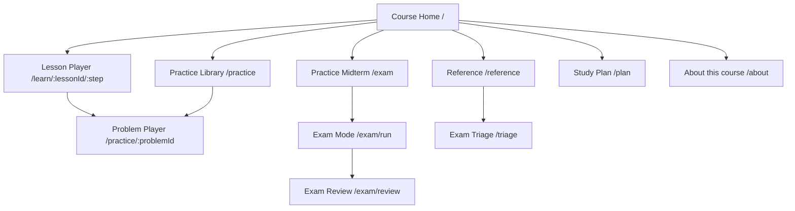
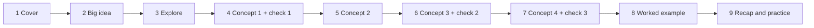

# Closed Loop: Full Redesign Spec for Midterm Academy

> **What this is:** A complete design-side spec for rebuilding the look, layout, flow, and teaching experience of `midterm-academy/`. It contains **no code**. It is detailed enough to implement directly. It keeps the content (7 lessons, 24 problems, 7 exam questions, curriculum data) and the 7 interactive labs. Everything that controls how that content is *presented* gets replaced.
>
> **Target feel:** a real online academy, the way Brilliant, Khan Academy, Coursera's lesson player, and Distill-style explainers feel. Sober, quiet, fluid, focused. One idea on screen at a time. Generous whitespace. Typography does the work, not boxes and colors.

---

## Table of contents

1. [Diagnosis: what is wrong today](#1-diagnosis-what-is-wrong-today)
2. [Design principles (the rules everything follows)](#2-design-principles)
3. [New information architecture](#3-new-information-architecture)
4. [Design tokens: color, type, space, radius, elevation, motion](#4-design-tokens)
5. [Global shell: top bar, navigation, footer](#5-global-shell)
6. [Page spec: Course Home](#6-page-spec-course-home)
7. [Page spec: Lesson Player (the heart of the academy)](#7-page-spec-lesson-player)
8. [Interactive labs: one unified layout](#8-interactive-labs-one-unified-layout)
9. [Plots and diagrams: visual style guide](#9-plots-and-diagrams-visual-style-guide)
10. [Page spec: Practice Library and Problem Player](#10-page-spec-practice)
11. [Page spec: Practice Midterm (Exam Mode)](#11-page-spec-practice-midterm)
12. [Page spec: Reference (replaces Cheat Sheet & Traps)](#12-page-spec-reference)
13. [Page spec: Exam Triage (replaces the 15-second classifier)](#13-page-spec-exam-triage)
14. [Page spec: Study Plan](#14-page-spec-study-plan)
15. [Component library](#15-component-library)
16. [Teaching patterns: making it more educational](#16-teaching-patterns)
17. [Copywriting and naming](#17-copywriting-and-naming)
18. [Responsive behavior](#18-responsive-behavior)
19. [Accessibility](#19-accessibility)
20. [File-by-file change map](#20-file-by-file-change-map)
21. [Implementation phases](#21-implementation-phases)
22. [Acceptance checklist](#22-acceptance-checklist)

---

## 1. Diagnosis: what is wrong today

These come from inspecting the current source (`App.tsx`, `TopNav.tsx`, `index.css`, every page in `src/pages/`, `ProblemStepViewer.tsx`) and screenshots of every tab at 1440×900 and 390×844.

### 1.1 Visual identity
| Problem | Where | Why it hurts |
|---|---|---|
| Generic "AI dark dashboard" look: navy `#090d16` canvas, `#0f1522` cards, neon sky-blue `#38bdf8` accent with glow shadows | `index.css`, every page | Reads like a crypto/devtools dashboard, not a place to learn. Dark navy plus cyan is the most recognizable AI-generated palette there is. |
| **Four accent colors used decoratively**: sky, amber, emerald, rose. Each label gets its own color ("Why this works" in amber, "Core Intuition" in emerald, "What you are given" in sky, "What you need to find" in amber) | `ProblemStepViewer.tsx`, `TheoryStudioPage.tsx`, `OverviewPage.tsx` | Color stops meaning anything. The eye has nowhere to rest, and green or red no longer signals right or wrong. |
| System font stack only (`ui-sans-serif, system-ui…`) | `index.css` | No typographic personality and no reading comfort. It also clashes with KaTeX's serif math. |
| All-caps tracked "eyebrow" labels everywhere ("MIDTERM READINESS", "3BLUE1BROWN INTUITION HOOK — FEEL IT BEFORE CALCULATING", "WHAT YOU ARE GIVEN", "TRAP / WRONG", "DEFENSE / RIGHT") | Everywhere | Shouty. Too many hierarchy signals compete. |
| Duotone icons in nearly every heading | All pages | Visual noise with no informational value. |

### 1.2 Crowding and structure
| Problem | Where |
|---|---|
| **Everything is a bordered rounded card**, and cards nest **three levels deep**. Example: the lab sits inside a "Interactive Visual Lab" card, which sits inside the page column, and the lab itself renders another card with its own header, presets, chart card, stat cards, formula card, and "What to notice" card. | Theory page, lab components |
| The lab repeats its title twice: the outer "Interactive Feedback Loop & Sensitivity Explorer" and the inner "INTERACTIVE LAB 1 · OPEN-LOOP VS CLOSED-LOOP FEEDBACK / Sensitivity, Disturbance Rejection…" | `TheoryStudioPage.tsx` plus the lab components |
| A single lesson page is **~5,500px tall** at 1440px wide. It stacks header, hook, lab, 4 sections, walkthrough, 3 MCQs, a 3-column tips grid, and a related-problems bar in one scroll. Nothing tells you where you are. | Theory page |
| The Roadmap/home page (~4,100px) mixes six unrelated jobs: hero marketing pitch, readiness stats, scope warning, lesson grid, a full flowchart tool, study-plan checklists, and an evidence table. | `OverviewPage.tsx` |
| Problems page: a filter bar with 14 chip buttons (6 sets plus 8 types), a 24-item card list, and a viewer that shows statement, plot, given, find, intuition, quick check, solution, and playbook all at once. | `ProblemBankPage.tsx`, `ProblemStepViewer.tsx` |
| Problem list sidebar clips under the sticky header when you scroll (item text cut off at the top edge). | `ProblemBankPage.tsx` aside with `max-h-[calc(100vh-140px)]` |
| Lesson rail cards show long metadata ("4. Chapter 2 · Sections 2.2 & 2.5 (Type D + DC Motor)") above the title, so each rail item takes 2–4 lines. | Theory page rail |
| The nav shows "0% ready (0/24 probs · 0/7 ch)" all the time. That is a scoreboard, not navigation. | `TopNav.tsx` |
| Study-plan buttons have redundant labels like "1-Hour Emergency Triage (60 Minutes (1.0 Hour))". | `OverviewPage.tsx` with `curriculum.studyPlans` |
| Cheat sheet: 10 trap cards, each split into a red box and a green box, in a 2-column grid. It is a wall of red and green. | `CheatSheetPage.tsx` |

### 1.3 Pedagogy and flow
- **No lesson flow.** A lesson is one big document, not a sequence of learning moments. There is no "Continue" and nothing paces you.
- **No URLs.** Navigation is React state only (`activeTab` in `App.tsx`). Back/forward don't work, you can't bookmark a lesson, and reloading always drops you on the Roadmap.
- **Concept checks come after all the reading.** They should be spread through the lesson, right after the idea they test.
- **"Why this works" is shown for every step automatically.** That takes away the student's chance to think first.
- **The exam has no real exam mode.** Nav, footer, and solutions buttons stay one click away the whole time.
- **Brand-name labels** ("3Blue1Brown Intuition Hook", "Khan-style checks") feel imitative. A real academy has its own voice.

---

## 2. Design principles

Every decision below follows these. When in doubt, re-read this list.

1. **One idea per screen.** Each view has one primary job and one primary action. Secondary things move to a drawer, a tab, or the next step.
2. **Whitespace instead of boxes.** Separate content with space, type size, and hairline rules. A container (card, panel) exists only when it means something: an interactive object, a self-check, or a figure. **At most one level of container nesting, anywhere.**
3. **Color means something or it isn't there.** Neutral ink on paper by default. **One** accent (ink blue) for interaction and progress. Green, red, and amber appear **only** as feedback states (correct, incorrect, caution) and as data colors inside plots.
4. **Reading comfort first.** 17px body, 1.7 line height, 68-character line length, serif headings that match KaTeX math.
5. **Think before you see.** Every reveal (step, answer, why) waits for the student. The interface paces learning and never dumps everything at once.
6. **The figure is the hero.** Plots and labs get the widest space and the cleanest frame. Controls are below or beside them and visually quieter.
7. **Calm motion.** Short fades and small rises, 150–240ms. No glows, no pulsing, no bouncing.
8. **You always know where you are.** Breadcrumb, lesson progress bar, step counter, and real URLs.

---

## 3. New information architecture

### 3.1 Sitemap



### 3.2 Where every current feature goes

| Current location | Current feature | New home |
|---|---|---|
| Roadmap hero | Marketing pitch plus 3 CTAs | **Removed.** Replaced by "Continue learning" on Course Home |
| Roadmap | Readiness stats | Course Home: one quiet progress line per unit plus an overall ring in the account area |
| Roadmap | Scope alert (Ch 4–6) | Course Home: dismissible **Note** banner (one line plus "Read more" linking to `/about#scope`) |
| Roadmap | 7-lesson grid | Course Home: **syllabus list** (vertical, not a card grid) |
| Roadmap | 15-second classifier (`RecognitionFlowchart`) | Its own page **`/triage`** ("Exam triage"), also linked from Reference and Exam |
| Roadmap | Study sprints (`studyPlans`) | Its own page **`/plan`** |
| Roadmap | Scope & evidence matrix (`scopeItems`) | **`/about`**, under "What's on the midterm" |
| Visual Theory | Everything | **Lesson Player** (paged beats, see §7) |
| 24 Solved Problems | Filter bar plus list plus viewer | **Practice Library** (list) plus **Problem Player** (focused page) |
| Practice Midterm | Everything | **Exam landing** → **Exam Mode** → **Review** |
| Cheat Sheet & Traps | Laplace pairs, block rules, traps, sanity gates, glossary, Ch 4–6 pivot | **Reference** (document with a sticky table of contents) |

### 3.3 Routing
- Use **hash-based routes** (works on any static host without server config): `#/`, `#/learn/ch2-laplace/3`, `#/practice`, `#/practice/E2.25`, `#/exam`, `#/exam/run`, `#/exam/review`, `#/reference`, `#/reference#laplace-pairs`, `#/triage`, `#/plan`, `#/about`.
- Browser back/forward must work everywhere. Reloading restores the exact view.
- Persist "last visited lesson + step" in the existing localStorage progress object so "Continue learning" has a target.
- On route change, scroll to top **without** smooth animation (instant), then move focus to the page `<h1>` for screen readers.

### 3.4 Navigation model
- **Top bar (global):** brand · Learn · Practice · Exam · Reference · (right) progress ring plus settings menu.
- **Inside a lesson:** the global bar is replaced by a **lesson bar** (see §7.2). Focus mode, no other navigation.
- **Inside the exam:** a **minimal exam bar** with a timer and a question index only.

---

## 4. Design tokens

All values below should become CSS custom properties defined once (in `index.css` under `@theme` for Tailwind v4, or as `:root` variables). **No component may use a raw hex value or a Tailwind palette color (`slate-*`, `sky-*`, etc.) directly.** Everything references tokens.

### 4.1 Color: Light theme ("Paper", the default)

| Token | Value | Use |
|---|---|---|
| `--bg` | `#F7F5F0` | App background (warm paper) |
| `--surface` | `#FFFFFF` | Raised objects: figure frames, check panels, menus |
| `--surface-sunken` | `#F0EDE6` | Math display wells, code-like readouts, input fields |
| `--rule` | `#E3DFD6` | Hairlines and dividers (1px) |
| `--rule-strong` | `#CFCAC0` | Input borders, table header rule |
| `--ink` | `#1D1C1A` | Headings, primary text |
| `--ink-2` | `#45423C` | Body text |
| `--ink-3` | `#76726A` | Secondary text, captions, metadata |
| `--ink-4` | `#A29E95` | Placeholder, disabled |
| `--accent` | `#24578F` | Primary buttons, links, active nav, progress, focus ring |
| `--accent-hover` | `#1C4675` | Hover/pressed |
| `--accent-soft` | `#E8EEF6` | Selected row and active item background |
| `--accent-ink` | `#FFFFFF` | Text on accent |
| `--correct` | `#2E7A4E` | Correct feedback text and icon |
| `--correct-soft` | `#E8F3EC` | Correct feedback background |
| `--incorrect` | `#B0412D` | Incorrect feedback text and icon |
| `--incorrect-soft` | `#F8EAE6` | Incorrect feedback background |
| `--caution` | `#8F6514` | Exam traps, warnings text |
| `--caution-soft` | `#F7F0DE` | Warning note background |

### 4.2 Color: Dark theme ("Night", optional via settings or `prefers-color-scheme`)

| Token | Value |
|---|---|
| `--bg` | `#141518` |
| `--surface` | `#1B1D21` |
| `--surface-sunken` | `#101114` |
| `--rule` | `#2A2D32` |
| `--rule-strong` | `#3A3E44` |
| `--ink` | `#EDEBE6` |
| `--ink-2` | `#C4C0B8` |
| `--ink-3` | `#8E8A83` |
| `--ink-4` | `#625F5A` |
| `--accent` | `#8DB6E2` |
| `--accent-hover` | `#A9C8EA` |
| `--accent-soft` | `#1F2A38` |
| `--accent-ink` | `#0E1A28` |
| `--correct` / `--correct-soft` | `#7CC49A` / `#17271E` |
| `--incorrect` / `--incorrect-soft` | `#E8907E` / `#2D1A16` |
| `--caution` / `--caution-soft` | `#D9B266` / `#2A2314` |

> [!IMPORTANT]
> Dark mode is **neutral charcoal**, not navy. No blue tint in backgrounds. No glow shadows.

### 4.3 Plot and data colors (both themes)

Colorblind-safe (Okabe–Ito-derived). These are the **only** colors allowed inside plots, block diagrams, and labs.

| Token | Light | Dark | Meaning: use consistently across the whole site |
|---|---|---|---|
| `--data-input` | `#24578F` | `#8DB6E2` | Input / reference signal `r(t)`, `u(t)`, controller path |
| `--data-output` | `#C2621A` | `#EFA463` | Output / response `y(t)`, plant |
| `--data-alt` | `#2E7A4E` | `#7CC49A` | Second response being compared (e.g. closed-loop vs open-loop), tangent lines |
| `--data-danger` | `#B0412D` | `#E8907E` | Disturbance `D(s)`, noise `N(s)`, unstable poles, error |
| `--data-muted` | `#8A857B` | `#7D7972` | Target/reference lines (dashed), asymptotes, ghost traces |
| `--plot-grid` | `#ECE8E0` | `#24272C` | Gridlines |
| `--plot-axis` | `#8A857B` | `#6F6B65` | Axes, ticks |
| `--plot-text` | `#45423C` | `#C4C0B8` | Tick labels, annotations |

**Rule:** the same physical quantity has the same color in **every** lab, every problem visual, and every exam diagram. Example: output `y(t)` is always orange, everywhere.

### 4.4 Typography

| Role | Font | Notes |
|---|---|---|
| Display and headings (H1–H2), lesson titles, big numbers in hero moments | **Source Serif 4** (variable, Google Fonts), weights 500–650 | Harmonizes with KaTeX's Computer Modern serif |
| UI, body text, H3–H4, buttons, labels | **Geist Sans** (variable), weights 400/500/600 | Clean and neutral |
| Numbers in readouts, timers, step counters, tick labels | **Geist Mono**, `tabular-nums` | |
| Math | KaTeX (unchanged) | Set KaTeX color to inherit `currentColor` so it follows the theme ink |

Load with `font-display: swap`, preload the two text weights you use most, and subset to Latin plus Greek.

**Type scale** (16px root):

| Token | Size / line-height | Font / weight | Tracking | Use |
|---|---|---|---|---|
| `display` | 44px / 1.08 | Serif 600 | −0.02em | Course Home greeting, lesson cover title |
| `h1` | 34px / 1.15 | Serif 600 | −0.015em | Page titles |
| `h2` | 25px / 1.25 | Serif 600 | −0.01em | Section titles within a lesson beat |
| `h3` | 19px / 1.35 | Sans 600 | −0.005em | Sub-sections, card titles |
| `h4` | 16px / 1.4 | Sans 600 | 0 | Step titles, small headings |
| `body-lg` | 19px / 1.65 | Sans 400 | 0 | Lesson hook paragraph, intro lede |
| `body` | 17px / 1.7 | Sans 400 | 0 | All explanatory text |
| `body-sm` | 15px / 1.6 | Sans 400 | 0 | Secondary explanations, table cells |
| `caption` | 13.5px / 1.5 | Sans 500 | 0.005em | Figure captions, metadata, helper text |
| `overline` | 12px / 1.4 | Sans 600, **small caps (not ALL CAPS)** | 0.04em | Used **rarely**: at most one per view (e.g. "Lesson 3 of 7") |
| `mono-sm` | 13px / 1.4 | Mono 500 | 0 | Tick labels, readouts |

Rules:
- Paragraph `max-width: 68ch`. Math display blocks may be wider (up to the content column).
- `text-wrap: pretty` on paragraphs and `text-wrap: balance` on headings.
- Sentence case everywhere. No Title Case Headings, no ALL CAPS labels.
- KaTeX inline size: `1.02em`. Display: `1.12em` with `margin-block: 20px`.

### 4.5 Spacing (4px base)

`--space-1: 4px` · `--space-2: 8px` · `--space-3: 12px` · `--space-4: 16px` · `--space-5: 24px` · `--space-6: 32px` · `--space-7: 48px` · `--space-8: 64px` · `--space-9: 96px`

| Context | Spacing |
|---|---|
| Between paragraphs | 20px (`1.2em`) |
| Heading to its first paragraph | 12px (h3) / 16px (h2) |
| Between sections within a beat | 48px |
| Between major page regions | 64–96px |
| Inside a figure frame | 24px (desktop), 16px (mobile) |
| Page side gutters | 24px (mobile), 40px (tablet), auto-centered (desktop) |

### 4.6 Layout widths
- `--w-read: 680px`: lesson reading column
- `--w-figure: 960px`: figures and labs (they *break out* of the reading column)
- `--w-page: 1120px`: library and reference pages
- `--w-shell: 1280px`: top bar content

### 4.7 Radius
- `--r-sm: 6px`: buttons, inputs, chips
- `--r-md: 10px`: check panels, menus, list rows on hover
- `--r-lg: 14px`: figure frames, lab frames
- **No pills** (`9999px`) except the progress ring and toggle switch track.

### 4.8 Elevation
- `--shadow-0`: none. **Default for everything.**
- `--shadow-1`: `0 1px 2px rgba(29,28,26,.06), 0 1px 1px rgba(29,28,26,.04)`, figure frames in light mode only
- `--shadow-pop`: `0 8px 24px rgba(29,28,26,.12), 0 2px 6px rgba(29,28,26,.08)`, menus, drawers, popovers
- Dark theme: no shadows. Use `--rule` borders instead.
- **Remove every colored glow** (`shadow-[0_0_20px_rgba(56,189,248,…)]` etc.).

### 4.9 Motion
| Token | Value | Use |
|---|---|---|
| `--ease-out` | `cubic-bezier(.2,.7,.2,1)` | Most transitions |
| `--dur-1` | 120ms | Hover color, button press |
| `--dur-2` | 200ms | Reveal fade, accordion |
| `--dur-3` | 280ms | Beat transition, drawer slide |

Patterns:
- **Reveal:** opacity 0→1 plus translateY 6px→0 over `--dur-2`.
- **Beat change (lesson step):** outgoing fades out (120ms), incoming fades and rises (200ms). No horizontal slides.
- **Button press:** `scale(.98)` for 120ms.
- **Progress bar fill:** width transition 400ms `--ease-out`.
- `prefers-reduced-motion: reduce` turns all of the above into instant opacity changes.
- Only `transform` and `opacity` are animated. Never animate height or width, except the accordion using the grid-rows technique.

### 4.10 Iconography
- Keep **Phosphor** but switch to **`regular` weight** (not duotone), 18px, `currentColor`.
- Icons are allowed only in: top-bar nav items (mobile only), buttons where they add meaning (play/pause timer, prev/next arrows, check mark for completion), and feedback states (check / x).
- **Remove icons from all headings and labels.**

### 4.11 Texture
- Optional, light mode only: a fixed full-screen noise overlay at **2% opacity** (pointer-events none) to take the sterile edge off the paper. Must be imperceptible at a glance. Skip it if it hurts performance.

---

## 5. Global shell

### 5.1 Top bar (all pages except Lesson Player and Exam Mode)

```
┌──────────────────────────────────────────────────────────────────────────────┐
│  ◯ Closed Loop          Learn   Practice   Exam   Reference          ◔  ⋯   │
│    Automatic Control                                                         │
└──────────────────────────────────────────────────────────────────────────────┘
```

- Height **60px**. Background `--bg` at 92% opacity with `backdrop-filter: blur(8px)`. Bottom hairline `--rule` appears **only after the page scrolls** (0 → 1 opacity).
- **Brand:** a small custom mark (a simple closed-loop glyph: circle with a feedback arrow, 20px, `--ink`) plus "Closed Loop" in Serif 600, 18px. Under it, a `caption` "Automatic Control · F030100" in `--ink-3`. On mobile, hide the subline.
- **Nav items:** text only, Sans 500, 15px, `--ink-2`. Active item: `--ink` plus a 2px underline in `--accent` offset 18px below the baseline (aligned with the bar's bottom edge). Hover: `--ink`. No background pills, no borders, no icons on desktop.
- **Right side:**
  - **Progress ring** (24px, 2.5px stroke, track `--rule`, fill `--accent`), showing overall completion. Hovering or focusing opens a small popover: "3 of 7 lessons · 5 of 24 problems · Practice exam not attempted". This replaces the "0% ready (0/24 probs · 0/7 ch)" chip.
  - **Overflow menu** (`⋯`): Theme (Light / Dark / System), Study plan, Exam triage, About this course, Reset progress (with confirmation).
- Max content width `--w-shell`, centered.

### 5.2 Mobile shell (<768px)
- Top bar: brand mark plus "Closed Loop" on the left, progress ring plus menu on the right. 56px tall.
- **Bottom tab bar** (fixed, 64px including safe-area inset): Learn · Practice · Exam · Reference, each with a regular-weight 22px icon and a 11.5px label. Active: `--accent` icon and label. Background `--surface` with a top hairline.
- Remove the current 5-column grid nav inside the header.

### 5.3 Footer
- One line, centered, `caption` in `--ink-3`: "Built from NCKU F030100 course slides, HW 1–4, and Dorf & Bishop 13e. Progress is saved in this browser." Followed by a "About this course" link.
- 64px top margin, 32px bottom padding. No border.
- Hidden in Lesson Player and Exam Mode.

---

## 6. Page spec: Course Home

**Job:** get the student back into learning in one click and show the shape of the course.

### 6.1 Wireframe (desktop, 1120px column)

```
  Good evening.                                          (display, serif)
  Midterm covers Chapters 1–3 and HW 1–4.                (body-lg, ink-3)

  ┌─ Continue learning ───────────────────────────────────────────────────┐
  │  Lesson 3 · The Laplace lens                       ▓▓▓▓▓░░░░  4 / 9   │
  │  Partial fractions, initial conditions, and the final value theorem   │
  │                                                     [ Continue → ]    │
  └───────────────────────────────────────────────────────────────────────┘

  ⓘ Chapters 4–6 may or may not be on the midterm. Confirm on Moodle. Read more   ✕

  Syllabus                                                    (h2, serif)
  ─────────────────────────────────────────────────────────────────────────
   1   Feedback and why sensitivity drops            Ch 1     ●  Done
   2   Linearization                                 Ch 2.3   ◐  4 of 9
   3   The Laplace lens                              Ch 2.4   ○
   4   Physical modeling and the DC motor            Ch 2.2–2.5
   5   Block diagram algebra                         Ch 2.6–2.7
   6   State variables and companion form            Ch 3.1–3.6
   7   State evolution and the transition matrix     Ch 3.6–3.7
  ─────────────────────────────────────────────────────────────────────────

  Practice                          Practice midterm
  24 worked problems                7 questions · 100 points · 90 minutes
  5 of 24 done                      Not attempted
  Browse problems →                 Start →

  Tools
  Exam triage — identify a problem type in 15 seconds →
  Study plan — 1, 3, 6, or 9 hour schedules →
  Reference — formulas, rules, and traps →
```

### 6.2 Details
- **Greeting:** time-based ("Good morning / afternoon / evening"). No hero marketing copy. Under it, one factual sentence about scope.
- **Continue learning card:** the **only** card on the page. `--surface`, `--r-lg`, `--shadow-1`, 28px padding.
  - Overline: "Lesson 3 of 7" (small caps).
  - Title in `h2` serif, subtitle in `body-sm` `--ink-3`.
  - Thin progress bar (4px, `--rule` track, `--accent` fill) with "4 / 9" in mono to the right.
  - Primary button "Continue" (or "Start the course" when there is no progress, linking to lesson 1 step 1).
- **Scope note:** inline note component (§15.7), caution style, single line plus "Read more" link plus dismiss ✕ (persist dismissal in localStorage).
- **Syllabus:** a **list, not cards.** Each row is 64px tall, with a hairline between rows.
  - Column 1: lesson number in Serif 500, 22px, `--ink-3`.
  - Column 2: title (`h4`, `--ink`). On hover the title turns `--accent`.
  - Column 3: chapter tag in `caption`, `--ink-3`, shortened (e.g. "Ch 2.4"; not "Chapter 2 · Section 2.4 (Type C)").
  - Column 4: status: `○` not started (`--ink-4`), `◐` in progress with "4 of 9", `●` done in `--correct` plus "Done".
  - The whole row is a link to `/learn/:id/:lastStep`.
  - **Exam weight** ("20–25% of midterm") moves to a hover tooltip on the chapter tag, or is shown only on the lesson cover (§7.4). It does not crowd the list.
- **Practice / Practice midterm:** two side-by-side **text blocks** (no cards), each with `h3`, one caption line, a status line, and a text link with an arrow.
- **Tools:** three text links with one-line descriptions, stacked.
- Vertical rhythm: 64px between greeting → continue card → note → syllabus → practice → tools.

### 6.3 Mobile
- Everything stacks. Syllabus rows hide the chapter column and show status as an icon only.

---

## 7. Page spec: Lesson Player

This is the core of the academy. **A lesson is no longer one long page. It is a short sequence of "beats"**, each one screen, paced by a Continue button, Brilliant-style. A "Read as one page" toggle stays available for revision.

### 7.1 Beat structure (mapped to existing data, nothing new to author)

Each `TheoryLesson` becomes **9 beats**. Verified current data: every lesson has 4 `sections`, 4–5 `workedWalkthrough.steps`, 3 `conceptChecks`, 4 `mentalModel` bullets.



| # | Beat | Data used | Primary action |
|---|---|---|---|
| 1 | **Cover** | `number`, `chapterTag`, `title`, `subtitle`, `examWeight`, estimated time | "Start lesson" |
| 2 | **Big idea** | `intuitionHook` (as the lede), `mentalModel[]` (as a numbered "What you'll understand" list) | "Continue" |
| 3 | **Explore** | `labTitle`, `labPrompt`, the lab component | "Continue" (always enabled; the lab is encouraged, not forced) |
| 4–7 | **Concept 1–4** | `sections[i].heading`, `explanation`, `math`, `whyItWorks`, `visualNote`. After concepts 1, 3, and 4, insert `conceptChecks[0..2]` at the end of the beat | Answer the check, then "Continue" |
| 8 | **Worked example** | `workedWalkthrough.title`, `context`, `steps[]`, `takeaway` | Step through, then "Continue" |
| 9 | **Recap** | `tipsAndTraps.memorize` → "Remember", `shortcuts` → "Shortcuts", `traps` → "Watch out", `relatedProblemIds` → "Practice now" | "Mark lesson complete" / "Next lesson" |

> [!NOTE]
> Checks are interleaved (after concept 1, 3, and 4) so retrieval happens right after learning. That is the single biggest teaching upgrade in this spec.

### 7.2 Lesson bar (replaces the global top bar)

```
┌──────────────────────────────────────────────────────────────────────────────┐
│ ✕   Lesson 3 · The Laplace lens          ▓▓▓▓▓▓▓▓░░░░░░░░░░         ☰  Aa   │
└──────────────────────────────────────────────────────────────────────────────┘
```
- 56px tall, `--bg`, hairline bottom.
- **✕ (Exit)**: returns to Course Home (or the previous page). Tooltip: "Exit lesson (progress saved)".
- **Title**: `caption` overline "Lesson 3" plus title in Sans 500, 15px, truncated with an ellipsis.
- **Segmented progress bar**: 9 segments with 3px gaps, each 4px tall. Completed segments `--accent`, current segment `--accent` at 50%, future `--rule`. Each segment is clickable (jump to beat) and has a tooltip with the beat name. Max width 360px, centered.
- **☰ Outline**: opens the lesson outline drawer (left, 320px) listing the 9 beats plus the other 6 lessons below a divider.
- **Aa**: reading settings popover: text size (S / M / L, which maps body to 16 / 17 / 19px), theme, "Read as one page" toggle.

### 7.3 Beat layout (desktop ≥1280px)

```
       ┌────────── 680px reading column ──────────┐   ┌─ 240px margin ─┐
       │                                          │   │                │
       │  Concept 2 of 4                          │   │  Margin notes  │
       │  Zero-input vs zero-state response  (h2) │   │  appear here,  │
       │                                          │   │  aligned with  │
       │  Body paragraphs…                        │   │  the paragraph │
       │                                          │   │  they annotate │
   ┌───┴──────────────── 960px figure ───────────┴───┐               │
   │                 math display / figure           │               │
   └───┬─────────────────────────────────────────────┬┘               │
       │  ▸ Why does this work?   (disclosure)       │                │
       │                                             │                │
       │                         [ Continue → ]      │                │
       └─────────────────────────────────────────────┘                │
```

- Reading column centered at `--w-read`. Figures, math wells, and labs break out to `--w-figure` (centered on the same axis).
- **Margin column** (≥1280px only): holds `visualNote` and step `tip` content as **margin notes**, in `caption` `--ink-3` with a 2px left rule in `--rule-strong`. Below 1280px, margin notes render inline below their paragraph as an "Aside" (§15.8).
- Beat content is vertically **top-aligned** with 64px top padding. Never vertically centered: it jumps when content length differs.
- **Bottom action area:** right-aligned primary "Continue" button. Left-aligned secondary "Back" text button. On mobile, both pin in a bottom action bar (§18).
- **Keyboard:** `→` / `Enter` = Continue (when enabled), `←` = Back, `1–4` = choose an option in checks, `O` = outline, `Esc` = close drawer.

### 7.4 Beat 1: Cover
```
                       Lesson 3 of 7
                The Laplace lens               (display, serif, centered)
     Partial fractions, initial conditions, and the final value theorem
                                                 (body-lg, ink-3, centered)

        Chapter 2.4  ·  About 25 min  ·  20–25% of midterm  (caption, ink-3)

                         [ Start lesson ]

             You'll practice: E2.4 · E2.31 · E3.14   (caption links)
```
- Centered composition, 120px top padding. The only centered beat.
- "About N min": estimate from content (e.g. 2 min per concept, 4 per worked example, 3 for the lab). Display it rounded.
- If the lesson is completed: show "Completed ✓" in `--correct` plus "Review lesson" (primary) and "Jump to recap" (text).

### 7.5 Beat 2: Big idea
- Overline "The big idea".
- `intuitionHook` rendered as the lede in **`body-lg`** (Sans 400, 19px) in `--ink`.
- Below, `h3` "By the end you'll understand" plus a **numbered list** of `mentalModel` items. Numbers are in Serif 500 `--ink-3`. 16px between items.
- No colored box. No icon. **Delete** the "3BLUE1BROWN INTUITION HOOK — FEEL IT BEFORE CALCULATING" label.

### 7.6 Beat 3: Explore (lab)
- `h2` = `labTitle` (deduplicated: the lab must **not** render its own title; see §8).
- One paragraph: `labPrompt`.
- Then the **lab frame** at `--w-figure` width (§8).
- Below the lab: a quiet `caption` line, "Play with it for a minute, then continue. You'll come back to this idea."

### 7.7 Beats 4–7: Concepts
Order inside each beat:
1. Overline "Concept 2 of 4".
2. `h2` = `section.heading`, with any leading numbering like "1." removed from the heading text.
3. `section.explanation` as body paragraphs. If the string is long, split on sentence boundaries into paragraphs of at most ~3 sentences.
4. `section.math` in a **math well** (§15.5) at figure width.
5. `section.whyItWorks` behind a **disclosure** "Why does this work?" (collapsed by default). Opening it reveals the text with a left rule in `--accent`. Remove the green box and the "Why this works:" label prefix.
6. `section.visualNote` → **margin note** (desktop) or **aside** (narrow).
7. If this beat has a concept check, it appears last, separated by 48px, as a **Check panel** (§15.3). **The Continue button stays disabled until an option is chosen.** It does not need to be correct: after a wrong answer, feedback shows, then Continue enables. Add a quiet "Skip" text link for revision mode.

### 7.8 Beat 8: Worked example
- Overline "Worked example". `h2` = `workedWalkthrough.title`. `context` as a paragraph.
- **Stepper** (§15.4): steps appear one at a time. The first step is shown; each subsequent step needs "Next step".
  - Each step: number in a 28px circle outline (`--rule-strong` border, Mono 13px), title in `h4`, math in a math well, and `reasoning` **hidden behind "Show reasoning"** (prompting the student to explain it themselves first).
  - Vertical 1px line in `--rule` connects step circles (timeline).
  - A text link "Show all steps" at the top right for revision.
- After the final step: **Takeaway** block. Serif 500 19px `--ink` with a 3px left rule in `--accent`, overline "Takeaway". No green box.

### 7.9 Beat 9: Recap
```
  Recap                                                  (h1 serif)

  Remember
  1  …memorize[0]
  2  …memorize[1]

  Shortcuts                         Watch out
  · shortcuts[0]                    · traps[0]
  · shortcuts[1]                    · traps[1] …

  Practice now
  ┌──────────────────────────────────────────────┐
  │ E2.4   Laser printer step response & FVT   → │
  │ E2.31  Complex poles & inverse Laplace     → │
  │ E3.14  …                                   → │
  └──────────────────────────────────────────────┘

  [ Mark lesson complete ]          Next: Lesson 4 · Physical modeling →
```
- **Remember:** numbered list, Serif numerals.
- **Shortcuts / Watch out:** two columns on desktop, stacked on mobile. Plain lists with an en-dash bullet. "Watch out" heading in `--caution` (text color only, no box).
- **Practice now:** a single bordered list (`--rule`, `--r-md`) with one row per `relatedProblemIds` item: code in Mono 14px `--ink-3`, title in Sans 500, chevron on the right. The row links to `/practice/:id?from=lesson-id` so the Problem Player can show "Back to lesson".
- Primary button "Mark lesson complete". Once done, it becomes "Completed ✓" (disabled look) and the "Next lesson" link becomes the primary button.

### 7.10 "Read as one page" mode
- Renders all 9 beats in sequence on one scrolling page, with 96px between beats and the beat overline as an anchor.
- Lesson bar progress reflects scroll position (IntersectionObserver).
- All disclosures stay collapsed. Checks remain interactive. Worked example shows all steps.
- This mode is the revision view and is remembered per user.

---

## 8. Interactive labs: one unified layout

There are 7 lab components (`FeedbackLab`, `LinearizationLab`, `LaplaceStepLab`, `MotorPhysicsLab`, `BlockDiagramLab`, `CompanionStateLab`, `TransitionMatrixLab`). Today each one has its own header, presets row, nested cards for chart, stats, formula, and notes, and its own color choices. **All 7 must adopt one layout.**

### 8.1 The lab frame

```
┌─ lab frame (--surface, --r-lg, 1px --rule, --shadow-1) ──────────────────────────┐
│  Scenario:  [ Nominal ][ Plant wears out ][ Wind gust ][ Noisy sensor ]   ↺ Reset │  ← toolbar
├───────────────────────────────────────────────────────────────────────────────────┤
│                                                                                   │
│                            FIGURE (plot / diagram)                                │  ← stage
│                    direct labels on curves, no legend box                         │
│                                                                                   │
├───────────────────────────────────────────────────────────────────────────────────┤
│  Forward gain K   ───●──────────  10          Plant drift ΔG  ──●───────  −40%    │  ← controls
│  Sensor gain H    ─────●────────  1.0         Disturbance  ◯ off   Noise ◯ off    │
├───────────────────────────────────────────────────────────────────────────────────┤
│  Sensitivity 9.1%    Open-loop error 40.0%    Closed-loop error 14.3%            │  ← readout strip
└───────────────────────────────────────────────────────────────────────────────────┘
   What to notice: Open-loop output falls 40% because it never measures y.           ← caption
   Closed loop shrinks the error by 1/(1+KGH).                         ▸ Show formula
```

**Zones, top to bottom:**
1. **Toolbar** (48px): "Scenario" label (caption, `--ink-3`) plus a **segmented control** of presets (§15.6), and a "Reset" icon button on the right. If a lab has modes (e.g. BlockDiagramLab's two modes), the mode switch is a **tab row** above the toolbar, never a second toolbar.
2. **Stage**: the plot or diagram, edge to edge inside the frame with 24px padding. Aspect ratio **16:9** for time plots, **1:1** for s-plane plots. When a lab shows two plots (e.g. s-plane plus step response), put them side by side at ≥1024px (1:1 plus 16:9 sharing a height) and stacked below that.
3. **Controls**: a 2-column grid of sliders and toggles (1 column on mobile). Each slider: label (Sans 500, 14px, `--ink-2`) with math in KaTeX, value on the right in Mono 14px `--ink`, track 4px `--rule`, filled part `--accent`, thumb 16px `--surface` with 1.5px `--accent` border. Min/max tick labels are **removed** unless they carry meaning (e.g. "−50% wear"), in which case they show in `caption` below the track.
4. **Readout strip**: horizontal row of key numbers, separated by 32px. Label in `caption` `--ink-3`, value in Mono 600 18px. A value is colored **only** if it maps to a plot series (e.g. closed-loop error in `--data-output` to match its curve). No individual stat cards.
5. **Caption** (outside the frame, below it): "What to notice:" in Sans 600 plus the dynamic explanation in `body-sm`. The formula (currently a separate "Closed-Loop Formula" card) goes behind a "Show formula" disclosure that expands a math well right there.

### 8.2 Lab rules
- **No title inside the lab.** The page provides it.
- **No icons** in lab labels.
- **No nested cards.** Zones are separated by 1px `--rule` hairlines inside the one frame.
- **No colored borders** on presets or zones.
- Every series color comes from §4.3 data tokens. Canvas-based labs read tokens via computed style at draw time and redraw on theme change.
- Toggles (Disturbance, Noise) use a **switch** component (§15.6), not "OFF" text buttons.
- HiDPI canvas rendering stays (it is good). Add a `ResizeObserver` debounce of 1 frame so slider drags never lag.
- Lab state persists while the student moves between beats in the same lesson (lift state or keep the component mounted and hidden).

### 8.3 Per-lab layout notes
| Lab | Stage | Notes |
|---|---|---|
| FeedbackLab | Step response 16:9 | Two curves: open-loop (`--data-alt`, dashed) and closed-loop (`--data-output`, solid). Target line `--data-muted` dashed. Direct labels at the right end of each curve. |
| LinearizationLab | Curve plus tangent 16:9 | Nonlinear curve `--data-input`, tangent `--data-alt`, operating point as a 7px filled dot with a thin crosshair to the axes. Δx/Δy shown as a small right triangle annotation. |
| LaplaceStepLab | s-plane 1:1 plus time response 16:9 | Poles as × (2px stroke, 10px), zeros as ○. Stable half-plane shaded with `--correct-soft` at 50% and the RHP with `--incorrect-soft` at 50%, very subtle. |
| MotorPhysicsLab | Schematic plus response | Schematic drawn with uniform 1.5px strokes, `--ink-2`. Signals colored by role (input `--data-input`, output `--data-output`). |
| BlockDiagramLab | Diagram 16:9 plus s-plane plus response | Mode tabs: "Positive vs negative feedback" / "Trace HW E2.25". The step selector becomes the stepper pattern (§15.4) shown in the caption area. |
| CompanionStateLab | Integrator cascade diagram plus response | Matrices A, B, C in a math well beside the diagram (≥1024px) or below it. The non-monic warning becomes an inline caution note (§15.7), not a red box. |
| TransitionMatrixLab | Phase portrait 1:1 plus x(t) 16:9 | Eigenvector directions as thin `--data-muted` lines; trajectory `--data-output`. |

---

## 9. Plots and diagrams: visual style guide

Applies to all 7 labs, all 24 `ProblemVisual` figures (`ProblemVisual.tsx`), the exam diagrams (`ExamDiagram.tsx`), and any static figure.

### 9.1 Figure frame
- Static figures (problem visuals, exam diagrams) sit in a **figure frame**: `--surface`, `--r-lg`, 1px `--rule`, 24px padding, **no title bar inside**.
- Caption **below** the frame: `caption` style, `--ink-3`, starting with "Figure." in Sans 600 `--ink-2`. Example: "**Figure.** Thermistor resistance vs temperature, with the tangent at 20 °C."
- Remove the current in-frame all-caps headers ("VISUAL INTUITION · THERMISTOR CURVE & TANGENT AT 20 °C").

### 9.2 Axes and grid
- Axis lines: 1px `--plot-axis`. Only the left and bottom axes. No box around the plot.
- Gridlines: 1px `--plot-grid`, horizontal only by default (add vertical only for time-domain plots where reading t matters).
- Ticks: 4px outward, 1px. 4–6 ticks per axis, rounded to nice numbers.
- Tick labels: Mono 12px, `--plot-text`.
- Axis titles: Sans 500 13px, `--plot-text`. Y title horizontal at the **top of the axis** (not rotated 90°), e.g. "y(t)" above the y-axis. X title at the right end of the x-axis, e.g. "t (s)".
- Units in parentheses with a thin space before: "R (Ω)", "t (s)".

### 9.3 Series
- Primary series: 2.25px stroke, round caps and joins.
- Secondary or comparison series: 1.75px.
- Reference and target lines: 1.25px, dash `6 4`, `--data-muted`.
- Asymptotes and helper lines: 1px, dash `2 3`, `--data-muted`.
- Points of interest: 6–7px filled circle in the series color with a 2px `--surface` ring (so it separates from the line).
- Fills (areas such as overshoot or error band): series color at 12% opacity.

### 9.4 Labels
- **Direct labels** at the end of each curve (Sans 500 13px, series color), offset 6px. **No legend boxes**: delete the current bottom legends ("— Nonlinear R(T) = … - - Tangent …").
- Annotations (e.g. "(20 °C, 1353 Ω)") in `caption` `--plot-text` with a thin 1px leader line to the point.
- All text inside SVGs uses the site fonts. Math inside SVG uses KaTeX through `foreignObject` or pre-rendered HTML overlays, never faked with plain-text italics.

### 9.5 Block diagrams and schematics
- Blocks: `--surface` fill, 1.25px `--ink-2` stroke, `--r-sm` corners, label centered in KaTeX at 15px. Plant and controller blocks are **not** color-filled. Color goes only on signal lines when a signal's role matters.
- Summing junctions: 18px circle, 1.25px stroke, with "+" / "−" signs in 12px Mono placed **outside** the circle at the entry side of each arrow.
- Signal lines: 1.25px `--ink-2`, orthogonal routing only (no diagonals), 8px arrowheads (filled, 30° half-angle).
- Signal labels (R(s), E(s), Y(s)…) in KaTeX 14px, placed **above** the line, centered on the segment.
- Disturbance and noise inputs: `--data-danger` for the arrow and label only.
- Pickoff points: 4px filled dot.
- Grid alignment: snap all block positions to an 8px grid. Equal spacing between blocks on the same row.

### 9.6 Interaction in figures
- Hover or touch on a curve shows a vertical crosshair (1px `--rule-strong`) plus a small tooltip (`--surface`, `--shadow-pop`, Mono 12px) with the values.
- Draggable handles (where they exist): 12px circle, `--surface` fill, 2px `--accent` stroke, cursor `grab`, 32px invisible hit area.

### 9.7 Quality bar
- Nothing overlaps: labels never collide with curves or each other (test at 360px, 768px, 1280px).
- No clipped text at any width.
- Strokes are crisp: half-pixel alignment for 1px lines in SVG, DPR scaling in canvas.
- Every figure has an `aria-label` describing what it shows, plus a visually hidden longer description where the figure carries meaning.

---

## 10. Page spec: Practice

### 10.1 Practice Library (`/practice`)

```
  Practice                                                  (h1 serif)
  24 worked problems from HW 1–4 and lecture examples.      (body, ink-3)

  [ All ]  HW 1  HW 2  HW 3  HW 4  Lecture examples          🔍 Search
  Problem type ▾          Status ▾                             (filters row)

  HW 1                                                       (h3, sticky subheader)
  ──────────────────────────────────────────────────────────────────────
  E2.2    Thermistor linearization           Linearization     ●○○○○   ✓
  E2.3    Graphical spring stiffness         Linearization     ●●○○○
  E2.4    Laser printer step response        Laplace & FVT     ●●●○○
  …
  HW 2
  ──────────────────────────────────────────────────────────────────────
  E2.19   Second-order step response         Laplace & FVT     ●●●○○   Key
  …
```
- **Grouped list**, not cards. Group headers (HW 1, HW 2, HW 3, HW 4, Lecture examples) stick under the top bar while scrolling.
- Row (56px): code (Mono 14px, `--ink-3`, fixed 64px column) · title (Sans 500, `--ink`) · type label (`caption`, `--ink-3`, a short human name, not "Type C") · difficulty as 5 small dots (filled `--ink-3`, empty `--rule-strong`) · status (✓ in `--correct` if done) · a "Key" marker (small caps, `--caution`, text only) for `priority === 'VERY HIGH'`, replacing the red "HIGH YIELD" badge.
- Row hover: `--accent-soft` background, `--r-md`. Whole row links to `/practice/:id`.
- **Filters:**
  - HW set: a segmented control (one row). "Recommended" is renamed "Lecture examples".
  - Problem type: a **dropdown** (not 8 chips) with human names: "Linearization (analytical)", "Linearization (graphical)", "Laplace & final value", "Physical modeling", "Block diagrams", "State-space modeling", "Transition matrix". Map from the existing type codes A–G using each problem's `typeLabel`.
  - Status dropdown: All / Not done / Done.
  - Search: a single 240px input with placeholder "Search problems". Pressing `/` focuses it.
- Empty state: "No problems match these filters." plus a "Clear filters" text button.

### 10.2 Problem Player (`/practice/:problemId`)

**Job:** attempt one problem with real effort, then learn from the solution.

```
  ← Practice   ·   HW 1   ·   E2.2                         ‹ Prev   3 of 24   Next ›

  Thermistor linearization                                  (h1 serif)
  Linearization · Difficulty ●●○○○ · Dorf p. 130            (caption)

  A thermistor has a response to temperature represented by R = R₀e^{−0.1T} …
  (problem statement, body, 680px)

  ┌ figure frame ────────────────────────────────────────────────┐
  │                  (original textbook figure if any)            │
  └──────────────────────────────────────────────────────────────┘
  Figure. …

  Given                              Find
  · R(T) = 10,000 e^{−0.1T} Ω         · Linear model ΔR = m ΔT around T₀
  · T₀ = 20 °C                         · Tangent-line approximation of R(T)
  · ΔT = T − T₀

  ─────────────────────────── Your turn ────────────────────────────
  Work it on paper first. When you're ready:

     [ Check my thinking ]  (quick check)     [ Start the solution ]

  ── Solution (after starting) ─────────────────────────────────────
  ① Find the operating point …             (stepper, one step at a time)
  ② Differentiate …
  ③ …
  ┌ Answer ────────────────────────────────────────────────┐
  │ ΔR ≈ −135 ΔT  Ω                                        │
  └────────────────────────────────────────────────────────┘
  Textbook answer: ΔR = −135 ΔT ✓ matches

  ── After you've seen it ──────────────────────────────────────────
  How did it go?   [ Need to redo ]   [ Mostly got it ]   [ Nailed it ]

  Exam notes   (tabs:  Spot it · Shortcut · Common mistakes · Remember)
```

#### Sections, in order
1. **Header bar** (not sticky): breadcrumb "← Practice · HW 1 · E2.2" on the left, "‹ Prev · 3 of 24 · Next ›" on the right (respects current library filters). If arriving from a lesson (`?from=`), the breadcrumb shows "← Back to Lesson 3".
2. **Title**: `h1` = `title` (without the code prefix, since the code sits in the breadcrumb). Meta line: human type label · difficulty dots · `source`. Remove the HW / type / priority badge row.
3. **Statement**: `originalStatement` as body text at reading width. No box and no "PROBLEM STATEMENT" label.
4. **Figure**: `figureUrl` (original textbook figure) in a figure frame with `figureCaption`.
5. **Given / Find**: two columns, plain lists with `h3` headings. No colored boxes.
6. **Your turn** divider: a centered hairline with the label "Your turn" in small caps `--ink-3`. Below it, one line: "Work it on paper first." Then two buttons:
   - "Check my thinking" (secondary): opens the `quickCheck` as a Check panel in place. Only shown for the 18 problems that have one.
   - "Start the solution" (primary): reveals the solution section with step 1.
7. **Visual intuition**: the bespoke `ProblemVisual` figure plus `coreIntuition` as its caption paragraph. Shown **after** "Start the solution" (it is a teaching aid, and showing it before the attempt gives the answer away). Heading `h3` "See it".
8. **Solution stepper** (§15.4): each step = title, math well, "Why?" disclosure holding `reasoning`, and `tip` as an aside. "Next step" button. Text link "Show full solution" at the top right of the section.
9. **Answer block**: after the last step. `--surface`, 1px `--correct` left border 3px, overline "Answer", `finalAnswer` in body-lg. Below it, if `bookAnswer` exists: "Textbook answer: … ✓ matches" in caption. This moves the textbook answer **out** of the statement area where it currently spoils the problem.
10. **Self-rating**: "How did it go?" with three segmented buttons. "Nailed it" marks it as mastered (maps to existing `masteredProblems`). The other two are stored as an optional new progress field (`shakyProblems`) to power "Review" filtering later. If adding a field is out of scope, show just "Mark as done".
11. **Exam notes**: **tabs** (§15.9): "Spot it" (`recognizeCue`), "Shortcut" (`shortcut`), "Common mistakes" (`commonMistakes[]`), "Remember" (`memorize`). Default tab: Spot it. Replaces the "Exam Playbook" accordion with four colored boxes.
12. **Footer nav**: large "Next problem: E2.3 Graphical spring stiffness →" link block (full width, hairline top, 72px tall).

---

## 11. Page spec: Practice Midterm

### 11.1 Exam landing (`/exam`)
```
  Practice midterm                                          (h1 serif)
  A full simulated exam in the style of F030100.

  7 questions · 100 points · 90 minutes · closed book

  How it works
  1  Work on paper. The timer runs, but you can pause it.
  2  Each question opens one at a time. Solutions stay hidden until you finish.
  3  Afterwards, grade yourself with the official-style rubric for every part.

  Mode   (•) Exam — solutions hidden until the end
         ( ) Study — reveal each part's solution as you go

  [ Start exam ]                         Last attempt: 72 / 100 · Nov 12
```
- Plain document page. One primary button.
- Questions overview below as a quiet list: "Q1 Conceptual foundations of feedback control · 12 pts", and so on (no chips grid).

### 11.2 Exam Mode (`/exam/run`)
- **No global top bar, no footer.** A minimal **exam bar** (56px):
  - Left: "✕ Exit" (asks for confirmation; progress is kept).
  - Center: question index: 7 small numbered squares (28px, `--r-sm`). Current = `--accent` fill, visited = `--ink` outline, flagged = small `--caution` dot on the corner.
  - Right: timer in Mono 600 18px, `85:12`. Turns `--caution` under 10 minutes and `--incorrect` under 2 minutes (text color only, no flashing). Pause/play icon button. "Finish" text button.
- **Question page:** one question per screen.
  - Overline "Question 3 of 7 · 16 points".
  - `h1` = question title. Topic tags as plain `caption` text joined by " · " (not chips).
  - `stem` as body. Diagram (`ExamDiagram`) in a figure frame using the plot style guide.
  - Parts (a), (b), (c) listed as **numbered sub-sections** with the part label in Serif 600 and points in `caption`: "(a)  4 points". Prompt text below.
  - Under each part: a **scratch note** textarea (optional), `--surface-sunken`, no border until focus, auto-grow, placeholder "Notes (optional)". Not one big textarea for the whole question.
  - In **Study mode only**: a "Show solution" disclosure per part.
  - Bottom: "← Previous" / "Flag for review" / "Next →".
- Keyboard: `←` / `→` between questions, `F` to flag.

### 11.3 Review (`/exam/review`)
- After "Finish" (or time running out). Shows "Grade yourself" mode:
  - Left sticky rail (240px) with the 7 questions and their running score "8 / 12".
  - Per part: the student's note (if any), then the solution stepper (all steps expanded), the `finalAnswer` block, then the **rubric checklist**: each `rubricItems` entry is a checkbox row "☐ Correct loop structure identified … 2 pts". Checking adds points.
  - `deductionWarning` shown as an inline caution note under the rubric.
- Top summary: big score "72 / 100" in Serif 600 48px plus a horizontal bar per question showing score vs max. Each bar links to that question's review.
- "Weak areas" list: the questions under 60%, each linked to the related lesson.
- Save the attempt (score plus date) in localStorage for "Last attempt" on the landing page.

---

## 12. Page spec: Reference

Replaces "Cheat Sheet, 10 Fatal Exam Traps & Sanity Gates". It's a **calm document**, printable.

### 12.1 Layout
```
 ┌ 220px sticky TOC ┐  ┌──────── 760px document ────────────────────────┐
 │ Laplace pairs    │  │ Reference                          (h1 serif)  │
 │ Block diagrams   │  │ Formulas, rules, and the mistakes that cost     │
 │ Common traps     │  │ marks.                    [ Print ] (text btn)  │
 │ Sanity checks    │  │                                                  │
 │ Notation         │  │ Laplace pairs                     (h2 serif)    │
 │ Chapters 4–6     │  │ ┌──────────────────────────────────────────────┐│
 │                  │  │ │ Name        f(t)            F(s)       Note ││
 │                  │  │ │ ...table rows...                             ││
 └──────────────────┘  └──────────────────────────────────────────────────┘
```
- Sticky TOC on the left (≥1024px): plain text links, `body-sm`, active section `--ink` with a 2px `--accent` left bar, others `--ink-3`. Below 1024px, the TOC becomes a "Jump to" dropdown at the top.
- Section order (all from `curriculum.ts`, verified counts): **Laplace pairs** (11) → **Block diagram rules** (8) → **Common traps** (10) → **Sanity checks** (5) → **Notation** (7) → **If Chapters 4–6 are included** (`ch46Pivot`).

### 12.2 Section styling
- **Laplace pairs:** a real table. Header row in `caption` Sans 600 `--ink-3` with a 1px `--rule-strong` bottom rule. Body rows with 1px `--rule` separators, 14px vertical padding. Math columns center-aligned. No zebra stripes. `note` in `caption` `--ink-3`.
- **Block diagram rules:** each rule as a row: a small inline SVG diagram (built per §9.5) on the left (200px), and on the right the name (`h4`), the formula in a math well, and the pitfall as a caution text line ("Pitfall: …" with "Pitfall" in `--caution`).
- **Common traps** (replaces 10 red/green box pairs):
  ```
  1  Feedback sign confusion                                       (h3)
     Flipping the loop sign corrupts every pole location, DC gain…  (body-sm, ink-3)

     ✕ Wrong    T(s) = G / (1 − GH) for a standard negative loop.
     ✓ Right    Negative feedback: denominator is 1 + GH.
  ```
  - Number in Serif 500 22px `--ink-3`, left column.
  - "✕ Wrong" label in `--incorrect` and "✓ Right" in `--correct`, Sans 600 14px, fixed 80px column. The text itself stays `--ink-2`. **No colored backgrounds.**
  - 40px between traps, with a hairline between them.
  - `whyStudentsLoseMarks` as the descriptive line under the title.
- **Sanity checks:** a numbered checklist with real checkboxes (session-only state) titled "Before you hand it in". Each item: title in `h4`, the check text in `body-sm`.
- **Notation:** a 2-column definition list (symbol in KaTeX on the left, meaning plus trap on the right).
- **Chapters 4–6:** a caution note at the top ("Only if your instructor confirms these chapters are in scope"), then topics as `h3` sections with their formulas in math wells.

### 12.3 Print stylesheet
- `@media print`: hide the top bar, TOC, buttons, and footer. Force the light theme. Body 11pt, headings in serif, 2cm margins, `break-inside: avoid` on each table row group, trap, and rule. Each top-level section starts with `break-before: auto` except Laplace pairs.

---

## 13. Page spec: Exam Triage

Replaces the "15-Second Exam Problem Classifier" (`RecognitionFlowchart.tsx`, 6 `flowchartSymptoms`).

- Page title: "Exam triage". Lede: "Looking at an exam question and not sure where to start? Answer two questions."
- **Step 1:** "What do you see on the page?" Show the 6 symptoms as a **vertical list of large option rows** (64px, `--r-md`, 1px `--rule`, hover `--accent-soft`), each with the prompt in Sans 500 and the cue in `caption`.
- **Step 2** (appears below with a reveal animation after a choice; step 1 collapses to a summary line "You see: Physical diagram given · Change"): "What is the question asking for?" Branch options as option rows.
- **Result** (after step 2): a single result panel:
  - Overline "This is a" plus `h2` problem-type name (human name, see §10.1).
  - "First move" heading plus `firstMove` text.
  - "Write this down first" heading plus `keyFormula` in a math well.
  - Links: "Review the lesson →" (to `/learn/:lessonId/1`) and "Practice: E2.21 · P2.26" (text links).
  - "Start over" text button.
- Remove the "15-SECOND TRIAGE LOCKED" label, the yellow selected-border styling, and the multiple nested cards.

---

## 14. Page spec: Study Plan

Replaces "Choose Your Study Sprint" from the home page. Data: 4 `studyPlans`.

- Title "Study plan". Lede: "Pick how much time you have. Each block uses the cover, attempt, compare, repair loop."
- **Duration picker:** segmented control with **short** labels: "1 hour" · "3 hours" · "6 hours" · "9 hours". Plan `name` and `subtitle` appear below as the selected plan's heading and description. Fixes "1-Hour Emergency Triage (60 Minutes (1.0 Hour))".
- **Timeline:** a vertical timeline with a 1px `--rule` line on the left. Each block:
  - Time range in Mono 13px `--ink-3` ("00:00–00:10") plus duration.
  - Focus text in Sans 500 `--ink`.
  - Target problem codes as plain text links in Mono 13px `--accent`, comma-separated (not chips).
  - A checkbox circle on the timeline line itself (20px). Checked = `--correct` fill plus check. The block text stays readable (no strikethrough; dim to `--ink-3` instead).
- A "Reset this plan" text button at the bottom.
- Optional: an "Exam date" field in settings, so the plan page can show "2 days left" as a quiet line. Only if the user sets it.

---

## 15. Component library

Build these once and use them everywhere. Each one lists its states.

### 15.1 Button
| Variant | Style |
|---|---|
| Primary | `--accent` bg, `--accent-ink` text, Sans 600 15px, 44px tall, 20px horizontal padding, `--r-sm` |
| Secondary | transparent bg, 1px `--rule-strong` border, `--ink` text |
| Text | no border or bg, `--accent` text, underline on hover (offset 3px, 1px) |
| Icon | 36px square, `--ink-3` icon, hover `--surface-sunken` bg |

States: hover (bg → `--accent-hover`; secondary border → `--ink-3`), active (`scale(.98)`), focus-visible (2px `--accent` ring with 2px offset in `--bg`), disabled (40% opacity, `not-allowed`). Optional trailing arrow icon for "Continue" and "Next" only.

### 15.2 Choice option (used in checks)
- Full-width row, min 52px, `--surface`, 1px `--rule-strong`, `--r-md`, 14px 16px padding.
- A leading key hint "A", "B", "C", "D" in Mono 12px inside a 22px square (`--rule` border). Pressing the key selects.
- **Single column** list (not a 2×2 grid; scanning a vertical list is easier and math wraps better).
- States:
  - Hover: border `--ink-3`.
  - Selected and correct: border `--correct`, bg `--correct-soft`, check icon replaces the key hint.
  - Selected and incorrect: border `--incorrect`, bg `--incorrect-soft`, x icon.
  - Correct but not selected (after a wrong answer): border `--correct` only (dashed 1px), no bg.
  - Others after answering: text `--ink-3`.
- Feedback text appears **below the list** in `body-sm`, prefixed with "Correct." or "Not quite." in Sans 600 with the matching color. `aria-live="polite"`.
- Add a "Try again" text button after a wrong answer (resets the selection, keeps the correct answer hidden).

### 15.3 Check panel
- Container for a concept check: `--surface`, 1px `--rule`, `--r-lg`, 28px padding.
- Overline "Check your understanding". Question in `h4` Sans 600 17px. Then choice options, then feedback.
- The **only** container used for checks. Don't put it inside another card.

### 15.4 Stepper (worked examples, solutions, exam solutions)
- Vertical timeline. Each step: a 28px outline circle with the step number (Mono 13px) on a 1px `--rule` line. Revealed steps show the full circle in `--ink-2`, the next step shows a dashed circle in `--ink-4` with the label "Step 3 of 4" plus a "Next step" secondary button.
- Step content: title `h4`, math well, "Why?" disclosure (reasoning), optional aside (tip).
- Reveal animation: §4.9 reveal pattern.
- Controls row at the top right of the stepper: "Show all" / "Reset" text buttons.

### 15.5 Math well
- `--surface-sunken`, `--r-md`, 20px 24px padding, horizontal scroll if overflowing (with a fade mask at the edges when scrollable).
- No border. Centered display math.
- Optional copy-as-LaTeX icon button (top right, appears on hover).

### 15.6 Segmented control, switch, slider
- **Segmented control:** a row of buttons inside a `--surface-sunken` track (`--r-sm`, 3px padding). Selected: `--surface` bg plus `--shadow-1` plus `--ink` text. Unselected: `--ink-3`. 34px tall. Text 14px Sans 500.
- **Switch:** 34×20 track (`--rule-strong` off, `--accent` on), 16px knob `--surface`. The label sits to the left.
- **Slider:** §8.1 control styling. Keyboard: arrows step, Page Up/Down step ×10.

### 15.7 Note (inline callout)
- Variants: **info** (`--ink-3` left rule), **caution** (`--caution` left rule and `--caution-soft` bg).
- 3px left rule, 14px 16px padding, `body-sm`. Optional bold lead word ("Note.", "Careful."). Optional dismiss ✕.
- **Max one note per view.** Never stack notes.

### 15.8 Aside / margin note
- Desktop ≥1280px: positioned in the right margin column, top-aligned with its anchor paragraph. `caption`, `--ink-3`, 2px left rule `--rule-strong`.
- Narrow: inline below the anchor, same styling, 16px top margin.

### 15.9 Tabs
- Text tabs with a 2px `--accent` underline on the active one, `--ink` active, `--ink-3` inactive. 1px `--rule` baseline under the whole row. Panels fade in (120ms). Arrow keys move between tabs (ARIA tabs pattern).

### 15.10 Disclosure
- Trigger: "▸ Why does this work?" in Sans 500 15px `--accent`. The chevron rotates 90° when open (120ms).
- Content: 12px top gap, left rule 2px `--accent` at 40% opacity, 16px left padding.

### 15.11 Progress indicators
- **Bar:** 4px tall, `--rule` track, `--accent` fill, `--r-sm` caps.
- **Segmented bar:** §7.2.
- **Ring:** §5.1.
- **Status glyphs:** ○ not started, ◐ in progress, ● done (`--correct`).

### 15.12 Drawer
- Slides in from the left (outline) or right (settings), 320px, `--surface`, `--shadow-pop`, scrim `rgba(0,0,0,.24)`. Focus trap, `Esc` to close, restores focus to the trigger.

### 15.13 Tooltip / popover
- `--surface`, `--shadow-pop`, `--r-md`, `caption` text, 8px 10px padding, 6px offset. Delay 400ms on hover, immediate on focus.

### 15.14 Empty, loading, and error states
- **Empty:** centered `body` `--ink-3` sentence plus one text action. Example: "No problems match these filters. Clear filters".
- **Loading** (labs mounting, fonts): skeleton blocks in `--surface-sunken`, matching the final layout's shape. No spinners.
- **Error** (e.g. figure image failed): inside the figure frame, "This figure couldn't load." plus "Retry" text button.

---

## 16. Teaching patterns

These make the site *more educational*, not just prettier. Each one uses existing data.

1. **Retrieval before reveal.** Checks are interleaved in lessons (§7.7). Problems ask for an attempt before showing the visual intuition or the solution (§10.2). Reasoning sits behind "Why?" so students try to explain it first.
2. **Worked example, then faded practice.** Recap (§7.9) links directly to related problems. In the Problem Player, the stepper is the "fading": the student reveals only as much help as they need.
3. **Pacing and chunking.** 9 beats per lesson, each about 2–4 minutes. Long explanations are split into ≤3-sentence paragraphs.
4. **Dual coding.** Every concept with a visual gets the figure *next to* the explanation (margin or breakout), never pages away. Consistent data colors (§4.3) mean "orange = output" becomes automatic across the site.
5. **Metacognition.** Self-rating after each problem ("Need to redo / Mostly got it / Nailed it"). Practice library status shows what needs revisiting.
6. **Spot-the-type training.** "Spot it" tab plus Exam triage page train recognition, which the midterm rewards.
7. **Clear end states.** Every lesson ends with a recap and an explicit next step. Every problem ends with a "Next problem" link. No dead ends.
8. **Low-stakes feedback language.** "Not quite." instead of red error styling. Wrong answers show *why* via existing `feedback` / `explanation` text.
9. **Exam realism.** Exam Mode removes all navigation and hides solutions, matching real conditions. Review uses the rubric to teach how marks are awarded.
10. **Return path.** "Continue learning" on Home, last step remembered, deep-linkable URLs.

---

## 17. Copywriting and naming

### 17.1 Voice
Plain, calm, specific, second person. Like a good TA. No hype, no exclamation marks, no imitation labels.

### 17.2 Rename table

| Current | New |
|---|---|
| Control Studio / F030100 Midterm Academy | **Closed Loop** / Automatic Control · F030100 |
| Roadmap | (Course) Home, reached via the brand mark |
| Visual Theory | **Learn** |
| 24 Solved Problems | **Practice** |
| Practice Midterm | **Exam** (nav) / Practice midterm (page title) |
| Cheat Sheet & Traps | **Reference** |
| "See the physics, then master every step." | *(removed: no hero)* |
| 7-Step Visual Mastery Path | Syllabus |
| 15-Second Exam Problem Classifier | Exam triage |
| Choose Your Study Sprint | Study plan |
| Verified Course Scope & Evidence Matrix | What's on the midterm (in About) |
| 3Blue1Brown Intuition Hook — Feel It Before Calculating | The big idea |
| Interactive Visual Lab | *(no label; the beat is "Explore")* |
| Why this works: | Why does this work? (disclosure) |
| Guided Walkthrough | Worked example |
| Check Your Understanding (Khan) | Check your understanding |
| Shortcuts / Exam Traps / Memorize | Shortcuts / Watch out / Remember |
| Practice this concept immediately in the Problem Bank: | Practice now |
| Mark Lesson Complete / Lesson Completed | Mark lesson complete / Completed |
| All 20 Homework Problems + 4 Professor Examples | Practice |
| Prof Tips (4) / Recommended | Lecture examples |
| Type A … Type G | Human type names (§10.1) |
| HIGH YIELD / VERY HIGH PRIORITY | Key (small caps marker) |
| Mark as Mastered / Mastered | How did it go? / Done |
| What You Are Given / What You Need To Find | Given / Find |
| Core Intuition (Big Picture Before Equations) | See it (caption of the visual) |
| Try This First — Quick Concept Check | Check my thinking |
| Step-by-Step Solution & Reasoning | Solution |
| Reveal Step 2 of 4 | Next step |
| Verified Final Answer | Answer |
| Textbook Answer Reference | Textbook answer |
| Exam Playbook: How to Recognize, Shortcut, Traps & What to Memorize | Exam notes |
| How to Recognize on Exam / Fastest Exam Shortcut / Common Mistakes to Avoid / Must-Memorize Takeaway | Spot it / Shortcut / Common mistakes / Remember |
| Simulated NCKU F030100 Exam · 7 Problems · 100 Points | 7 questions · 100 points · 90 minutes |
| Practice Midterm & Interactive Grading Key | Practice midterm |
| Reveal Full Key & Rubric | Show solution (Study mode only) |
| Your Scratchpad Notes / Setup (Optional) | Notes (optional) |
| Self-graded score | Your score |
| Last-Minute Brain Reload | *(removed)* |
| Cheat Sheet, 10 Fatal Exam Traps & Sanity Gates | Reference |
| The 10 Highest-Frequency Exam Traps | Common traps |
| TRAP / WRONG · DEFENSE / RIGHT | ✕ Wrong · ✓ Right |
| Sanity Gates | Before you hand it in |
| 0% ready (0/24 probs · 0/7 ch) | Progress ring plus popover |

### 17.3 Content hygiene
- Strip "Lesson N ·" duplicates and numbering prefixes from headings where the UI already shows the number.
- Shorten `chapterTag` for display: "Chapter 2 · Section 2.4 (Type C)" → "Ch 2.4". Keep the full value for the cover meta line only.
- Edit the data strings directly during implementation (not at render time) (a copy pass over `theoryLessons.ts`, `homeworkProblems.ts`, `curriculum.ts`) for exclamation marks, ALL-CAPS words used for emphasis ("ALWAYS", "MUST", "NOT"), and hype words. Use *italics* for emphasis instead.

---

## 18. Responsive behavior

| Breakpoint | Behavior |
|---|---|
| **≥1280px** | Lesson: reading column 680 plus right margin column 240 for asides; figures at 960. Reference: TOC plus document. Library: full row columns. |
| **1024–1279px** | Margin notes become inline asides. Lesson outline is a drawer only. Labs keep side-by-side dual plots. |
| **768–1023px** | Labs stack plots vertically. Controls in 2 columns. Reference TOC becomes a "Jump to" dropdown. Library hides the difficulty column. |
| **<768px** | Bottom tab bar (global pages). Lesson and exam get a **bottom action bar** (64px plus safe area): "Back" (text) and "Continue" (primary, flex-grow). Figures go full-bleed (frame loses side borders and radius, 16px padding). Controls in 1 column. Body text 17px stays (never smaller than 16px). Problem Player prev/next goes into the bottom bar. Exam index squares scroll horizontally. |

Other rules:
- Use `min-height: 100dvh`, never `100vh`.
- Touch targets ≥ 44×44px.
- Math wells scroll horizontally on overflow; the page body never scrolls horizontally.
- Test at 360, 390, 768, 1024, 1280, 1440, and 1920px.

---

## 19. Accessibility

- **Contrast:** all text ≥ 4.5:1 against its background (`--ink-3` on `--bg` is designed to pass; verify with a checker). Plot lines ≥ 3:1 against `--surface`.
- **Never color alone:** correct/incorrect also use ✓ / ✕ icons and the words "Correct." / "Not quite.". Plot series also differ by dash pattern or direct label.
- **Focus:** visible 2px `--accent` ring with offset on every interactive element. Logical tab order. Skip link "Skip to content" as the first focusable element.
- **Keyboard:** all lab controls, choices (1–4 / A–D), steppers, tabs, drawers, exam navigation.
- **Semantics:** `<header>`, `<nav>`, `<main>`, `<article>` for lessons and problems, `<aside>` for margin notes, `<figure>` + `<figcaption>` for figures, `<table>` for Laplace pairs, real `<button>` and `<a>` (links for navigation, buttons for actions).
- **Live regions:** check feedback, timer warnings (at 10 and 2 minutes only), score updates.
- **Reduced motion:** honored everywhere (§4.9).
- **Math:** KaTeX outputs MathML; keep it enabled for screen readers.
- **Language:** `<html lang="en">`.

---

## 20. File-by-file change map

Implementation reference only. It lists which files change and how; it doesn't prescribe code.

| File | Change |
|---|---|
| `index.html` | Title "Closed Loop · Automatic Control", meta description, theme-color for both themes, font preloads, favicon with the loop mark |
| `src/index.css` | Replace the root variables with the full token set (§4). Add font faces, base typography, KaTeX color inheritance, print stylesheet, reduced-motion rules, focus ring. Remove the dark-only `color-scheme` and the chalkboard scrollbar. |
| `src/App.tsx` | Replace `activeTab` state with hash routing. Add routes from §3.3. Store last lesson/step. Theme provider (light/dark/system). Remove the footer from lesson and exam routes. |
| `src/components/TopNav.tsx` | Rebuild as the global top bar (§5.1) plus mobile bottom tab bar (§5.2). Remove the readiness chip and icons on desktop. |
| **New** `LessonBar`, `LessonPlayer`, `Beat*` components | §7 |
| `src/pages/OverviewPage.tsx` | Becomes Course Home (§6). Move the flowchart, study plans, and scope matrix out. |
| `src/pages/TheoryStudioPage.tsx` | Replaced by the Lesson Player. The lesson rail goes into the outline drawer. |
| `src/pages/ProblemBankPage.tsx` | Becomes the Practice Library (§10.1). The list/viewer split goes away. |
| `src/components/ProblemStepViewer.tsx` | Becomes the Problem Player (§10.2): reordered sections, stepper, tabs, self-rating. |
| `src/pages/PracticeExamPage.tsx` | Splits into Exam landing, Exam Mode, and Review (§11). |
| `src/pages/CheatSheetPage.tsx` | Becomes Reference (§12). |
| `src/components/RecognitionFlowchart.tsx` | Becomes the Exam Triage page (§13). |
| **New** `StudyPlanPage`, `AboutPage` | §14, plus scope matrix |
| `src/components/InteractiveLabs/*.tsx` (7 files) | Adopt the lab frame (§8). Remove internal titles, icons, and nested cards. Read data color tokens. Switch to the shared segmented control, switch, and slider. |
| `src/components/ProblemVisual.tsx` | Apply the plot style guide (§9). Remove in-frame headers and legends. Add direct labels and token colors. Caption moves outside. |
| `src/components/ExamDiagram.tsx` | Apply the block-diagram rules (§9.5) and token colors. |
| `src/components/MathText.tsx` | No visual changes beyond inheriting `currentColor`. Make sure display math renders inside math wells. |
| **New** `src/components/ui/*` | Button, ChoiceOption, CheckPanel, Stepper, MathWell, SegmentedControl, Switch, Slider, Note, Aside, Tabs, Disclosure, ProgressBar, ProgressRing, Drawer, Tooltip, FigureFrame |
| `src/data/*.ts` | Copy pass only (§17.3). No structural changes. Optional new progress field `shakyProblems` and `examAttempts` in localStorage (in `App.tsx`, not the data files). |
| `visual_qa.py` | Extend: screenshot every new route at 390 / 1024 / 1440 in both themes; assert no horizontal overflow, no console errors, and that headings exist. |

---

## 21. Implementation phases

Do them in order. Each phase ends with a working, shippable site.

| Phase | Scope | Done when |
|---|---|---|
| **1. Foundations** | Tokens, fonts, base typography, light/dark themes, component library (§15), hash routing, new top bar | Every existing page renders with the new tokens and no raw palette classes remain in shell components |
| **2. Lesson Player** | §7 beats, lesson bar, outline drawer, read-as-one-page mode, interleaved checks | All 7 lessons playable end to end via keyboard; progress and last step persist |
| **3. Labs** | §8 frame across all 7 labs; data color tokens; dedupe titles | Each lab matches the frame wireframe at 390 / 1024 / 1440; no nested cards |
| **4. Practice** | Library plus Problem Player (§10) | All 24 problems reachable via library, prev/next, and lesson recap; self-rating stored |
| **5. Figures** | Plot style guide (§9) applied to all 24 `ProblemVisual`s and the exam diagrams | Visual QA screenshots show no legends, direct labels everywhere, no clipped text |
| **6. Exam** | Landing, Exam Mode, Review (§11) | Full timed attempt possible, rubric grading works, attempt saved |
| **7. Reference, Triage, Plan, Home, About** | §6, §12–§14 | Home shows "Continue learning"; reference prints cleanly on A4 |
| **8. Copy and QA pass** | §17 rename table, data copy pass, §19 accessibility audit, §22 checklist | Checklist fully green |

---

## 22. Acceptance checklist

**Look**
- [ ] Default theme is the warm light "Paper" theme. Dark theme is neutral charcoal, never navy.
- [ ] Exactly one accent color is used for UI. Green, red, and amber appear only as feedback, cautions, or plot data.
- [ ] Serif headings plus sans body are loaded. No system-font fallback visible after load.
- [ ] No ALL CAPS labels. At most one small-caps overline per view.
- [ ] No icons in headings.
- [ ] No glow shadows. No colored borders used decoratively.
- [ ] No container is nested inside another container anywhere.

**Focus and flow**
- [ ] Every view has exactly one primary button.
- [ ] Lessons are 9 paced beats with a segmented progress bar. Checks are interleaved.
- [ ] Back/forward work. Reload restores the exact view. Lesson and problem URLs are shareable.
- [ ] "Continue learning" on Home goes to the last beat visited.
- [ ] Exam Mode has no global nav or footer, and solutions are hidden in Exam mode.

**Teaching**
- [ ] Solutions, reasoning, visual intuition, and textbook answers are all hidden until the student acts.
- [ ] Every lesson ends with a recap plus practice links. Every problem ends with a "Next problem" link.
- [ ] Self-rating after problems is stored and visible in the library.

**Figures**
- [ ] All plots use data tokens. The same quantity has the same color everywhere.
- [ ] No legend boxes. Direct labels only. No overlapping or clipped labels at 360 / 768 / 1280px.
- [ ] Block diagrams use orthogonal routing, an 8px grid, and consistent stroke weights.
- [ ] Labs follow the frame: toolbar → stage → controls → readout → caption. No inner titles.

**Quality**
- [ ] No horizontal page scroll at any width from 360px up.
- [ ] Text contrast ≥ 4.5:1. Focus ring visible on every control.
- [ ] Reduced motion honored.
- [ ] Reference prints cleanly.
- [ ] TypeScript check, production build, KaTeX check, and visual QA script all pass with zero errors.
